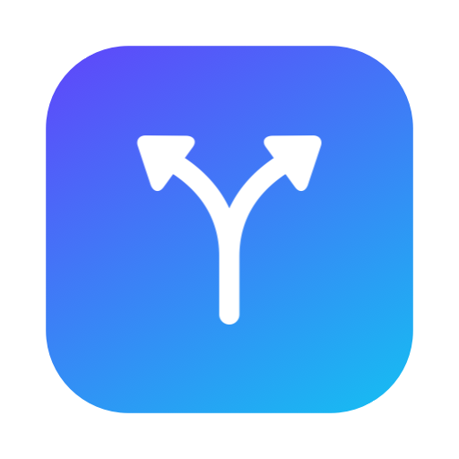
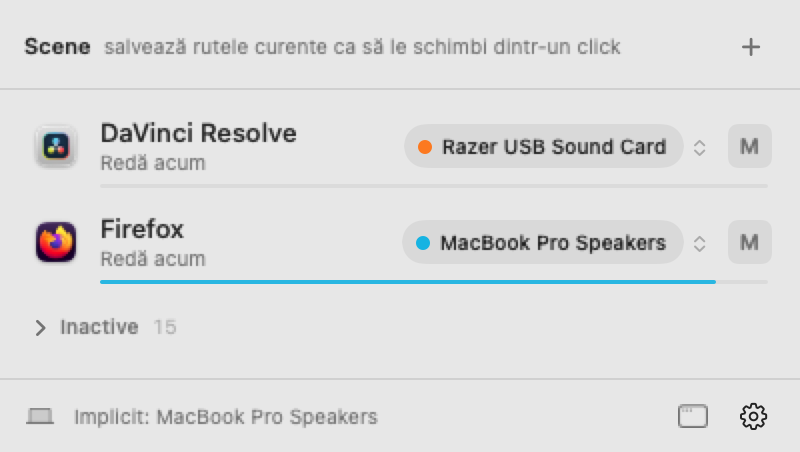

<div align="center">



# AudioDiverger

**Every app, on its own speaker.**
DaVinci in your headphones, the browser on your laptop speakers, at the same time.

[](https://github.com/DavidGG13/AudioDiverger/releases/latest)


[](LICENSE)

<picture>
  <source media="(prefers-color-scheme: dark)" srcset="docs/screenshot-dark.png">
  
</picture>

</div>

---

macOS sends all sound to a single output. If you're editing in DaVinci Resolve with headphones on and want a tutorial, music or a call to play on the laptop speakers (or the other way round), you're out of luck.

**AudioDiverger** lets you choose where each app plays. It sits quietly in your menu bar and installs no drivers.

## Features

- 🎧 **Per-app output.** Every app is a *track*, like in an editing timeline. Send it to headphones, speakers, an audio interface or any other output.
- 🔀 **Several outputs at once.** The same app can play in your headphones *and* on the speakers at the same time.
- 🔇 **Per-app mute and volume.**
- 📈 **Live level meters**, colored by the device each app is playing on.
- 🎬 **Scenes.** Save setups like "Editing" or "Call" and switch between them in one click, or with **⌃⌥⌘1 … ⌃⌥⌘9** from any app.
- 🪶 **Practically free to run.** Lives only in the menu bar, with no Dock icon and no polling. It uses ~0% CPU when nothing is routed.
- 🔌 **Remembers everything.** Routes come back when an app relaunches or a device reconnects. If a device disappears, its apps fall back to the system output, so sound is never lost.

## Install

1. Download **`AudioDiverger-x.y.z.dmg`** from [Releases](https://github.com/DavidGG13/AudioDiverger/releases/latest).
2. Drag **AudioDiverger** into **Applications**.
3. On first launch, **right-click → Open → Open**. The app is free and not notarized by Apple.
4. The first time you route an app, macOS asks for **System Audio Recording** permission. Allow it: that's how AudioDiverger picks up an app's sound.

> Requires macOS **14.2 or later**. Runs natively on Apple silicon and Intel.

## Usage

1. Click the menu bar icon.
2. Play something in any app. It appears as a track. Apps that aren't making sound are tucked under "Idle".
3. Click a track's output and tick one or more devices. The volume slider is there too.
4. **M** mutes the app.
5. **+** saves the current routes as a scene. Right-click a scene to update or delete it.

**Example:** keep the system output on *MacBook Speakers*, send DaVinci Resolve to your *headphones*, and leave the browser on *Default*.

## How it works

AudioDiverger is built on **Core Audio process taps**, Apple's native API since macOS 14.2. It needs no kernel extensions and no virtual audio drivers (such as BlackHole or Loopback).

For every routed app:

1. a **process tap** captures the app's audio and mutes it on its original output;
2. a private **aggregate device** joins the tap with the device or devices you picked;
3. a real-time IOProc copies the audio across, applying volume and measuring level for the meter.

Muting an app without routing it uses only a muted tap, with no IO at all. Meters run only while the menu is open.

## Known limitations

- **Bluetooth headsets with a microphone (AirPods etc.).** AudioDiverger turns the mic stream off to keep high-quality audio, but some models may still switch to "headset" mode.
- Routing adds a small amount of latency (a few milliseconds).
- Audio is sent in stereo to the first two channels of each device.

## Build from source

You need Xcode or the Command Line Tools (Swift 6).

```bash
git clone https://github.com/DavidGG13/AudioDiverger.git
cd AudioDiverger
./scripts/build_app.sh --install      # add --universal for Apple silicon + Intel
./scripts/make_dmg.sh                 # optional: build/AudioDiverger-<version>.dmg
```

Pushing a `v*` tag builds and publishes a release automatically ([`.github/workflows/release.yml`](.github/workflows/release.yml)).

<details>
<summary>Project layout</summary>

```
Sources/AudioDiverger/
  AudioDivergerApp.swift   # menu bar extra + optional window
  Views.swift              # SwiftUI UI (tracks, scenes, meters)
  AudioModel.swift         # state, persistence, scenes, route reconciliation
  AppRoute.swift           # tap + aggregate device + IOProc (the audio engine)
  AudioApp.swift           # audio processes grouped by app
  OutputDevice.swift       # output devices
  HotKeys.swift            # global scene shortcuts
  CoreAudioHelpers.swift   # Core Audio wrappers
  Snapshot.swift           # offscreen UI rendering (development)
```

</details>

## Contributing

Issues and pull requests are welcome. If something doesn't route the way you expect, please open an issue and include your macOS version, the app and the output device.

<div align="center">

MIT © <a href="https://github.com/DavidGG13">EasyInfoTech</a>

</div>
